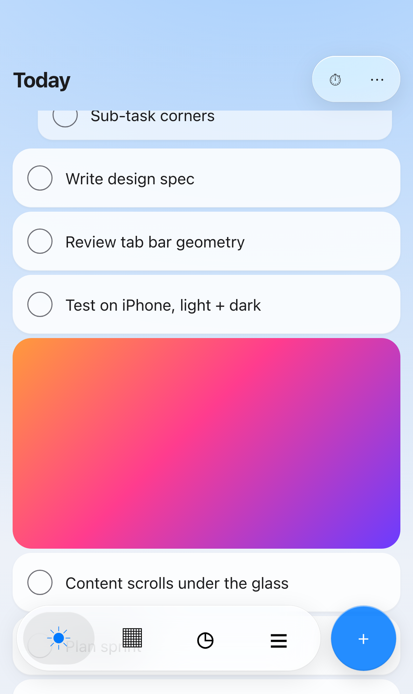
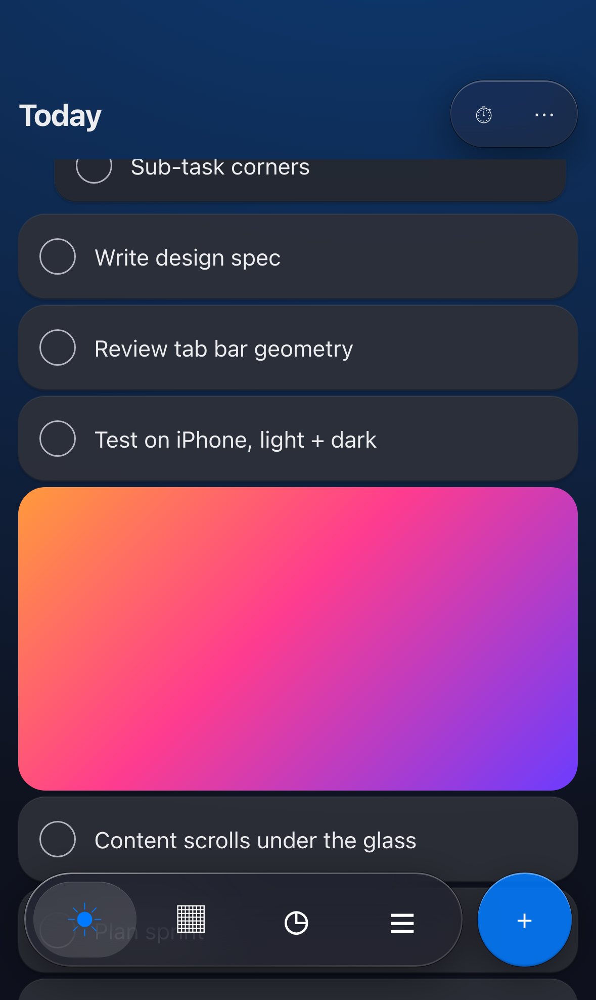
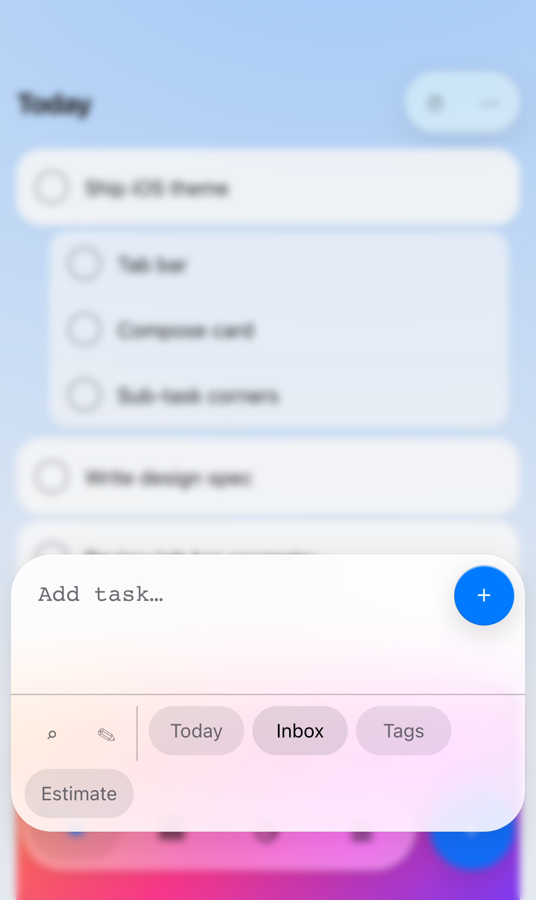

# Liquid Glass UI for Super Productivity

A Liquid Glass look (in the spirit of iOS 26 / macOS Tahoe) for
[Super Productivity](https://super-productivity.com), in light and dark mode,
on Mac, iPhone, iPad, Android, Windows, Linux and the web app.

It is **one plugin**: the theme is bundled inside, so there is nothing else to
install. Everything is set from the plugin's own settings page.

| iPhone, light | iPhone, dark | Add task |
|---|---|---|
|  |  |  |

## Features

- **Glass where Apple puts it:** sidebar, header controls, floating tab bar,
  add-task card, dialogs, menus and notifications. Content (task rows,
  details, forms) stays solid and readable.
- **Wallpapers:** Aurora, Ocean, Sunset, Graphite, or your own (gradient,
  colour blobs, dot / grid / line pattern) for light and dark mode.
- **Accent colour:** iOS system colours with Apple's light, dark and
  increased-contrast variants, or a custom colour. Used for the primary
  actions, the selected item and the short-syntax highlight.
- **Mac:** a toolbar row aligned with the window buttons, a floating glass
  sidebar, concentric corners.
- **iPhone:** floating tab bar that minimizes while scrolling, a separate add
  button, roomy add-task card above the keyboard, iOS sheets.
- **Scroll edge effect** (Off / Soft / Hard): content fades out under the
  header and above the tab bar.
- **Glass strength:** Clear / Regular / Tinted.
- **Accessibility:** follows Reduce Transparency, Increase Contrast and
  Reduce Motion, live.
- **Diagnostics** page for checking what your device supports.

The plugin sends nothing off your device (`dataSharing: []`, no network
permissions). Its settings sync with your Super Productivity data.

## Install

Requires Super Productivity **20.0.0** or newer.

1. Download `liquid-glass-ui-<version>.zip` from
   [Releases](https://github.com/nkte-X/sp-liquid-glass-ui/releases).
2. Super Productivity → **Settings → Plugins → Install Plugin** → choose the
   ZIP, confirm, and switch the plugin on.
3. **Settings → Theme:** keep **Default** (the plugin brings its own theme).
4. Open **Liquid Glass UI** in the side menu to pick a wallpaper, accent and
   the rest.

Plugins are installed per device: repeat on each device you use.

Upgrading from the earlier `iOS Glass Layer` builds: remove that plugin first
(it has a different id, and both would style the app at once). Its settings
are not carried over.

## Known limitations

- Real background refraction is not possible in the web views the app uses;
  the glass is blur, tint, rim light and shadow.
- The plugin relies on the app's DOM, not an official styling API. After an
  app update, check the **Diagnostics** section if something looks off and
  open an issue.
- Haptics on iOS are experimental.

## Build from source

```sh
cd plugin
npm install
npm run smoke     # builds theme + plugin, runs the WebKit smoke test
npm run package   # → plugin/liquid-glass-ui-<version>.zip
npm run release   # smoke + package + SHA-256 and the community listing entry
```

Layout:

- `themes/src/base-liquid-glass.css`: upstream theme snapshot (do not edit)
- `themes/src/ios-layer.css`: the Liquid Glass UI layer
- `plugin/`: the plugin (host script in `src/plugin.ts` + `src/host/`,
  settings UI in `src/app/`, Solid.js)
- `preview/ios-preview.html`: mock app page for the smoke test
- `docs/`: design spec and audit notes (Russian)

## License

[PolyForm Noncommercial 1.0.0](LICENSE): free to use, change and share for
any **noncommercial** purpose. Commercial use needs separate permission.

The bundled base theme comes from Super Productivity and stays under the MIT
license; see [NOTICE.md](NOTICE.md). Not affiliated with Apple or the Super
Productivity project.
